# Atelier 2 - Deep Learning avec PyTorch

Ce TP porte sur la classification d'images avec PyTorch. J'ai travaillé avec plusieurs architectures : un CNN, Faster R-CNN, VGG16, AlexNet et un Vision Transformer (ViT). Les expériences ont été réalisées sur Kaggle avec un GPU Tesla T4.

J'ai utilisé le dataset MNIST complet : **60 000 images pour l'entraînement** et **10 000 images pour le test**. Chaque image représente un chiffre de 0 à 9 en 28 × 28 pixels.

## 1. Présentation des données

Le dataset MNIST contient des images en niveaux de gris et dix classes, de 0 à 9. J'ai vérifié le nombre d'images et la répartition des classes, puis préparé les données pour les différents modèles.

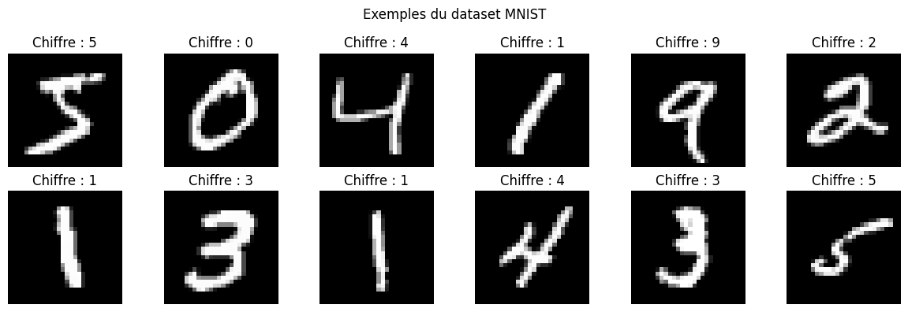

## 2. Partie 1 - CNN Classifier

### CNN avec PyTorch

J'ai commencé avec un CNN construit avec PyTorch. Il contient deux couches de convolution, des couches ReLU, du MaxPooling, puis des couches fully connected. J'ai aussi utilisé BatchNorm et Dropout.

Le CNN a été entraîné pendant **5 epochs** sur les 60 000 images. Sur le jeu de test, il obtient :

- **Accuracy : 99,11 %**
- **Macro F1-score : 0,9910**
- **Test Loss : 0,0286**
- **Temps d'entraînement : 46,4 s**

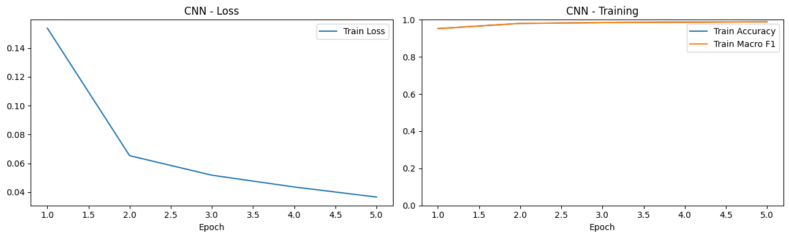

### Faster R-CNN

J'ai ensuite utilisé Faster R-CNN, avec un backbone MobileNetV3 préentraîné. Ce modèle est surtout conçu pour la détection d'objets. Pour l'appliquer à MNIST, chaque image a été associée à une boîte englobante autour du chiffre et à sa classe.

Après **2 epochs**, le modèle obtient **98,40 % d'Accuracy** et un **Macro F1-score de 0,9839**. Le temps d'entraînement est de **1 638,0 s**.

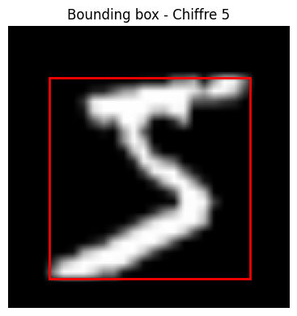

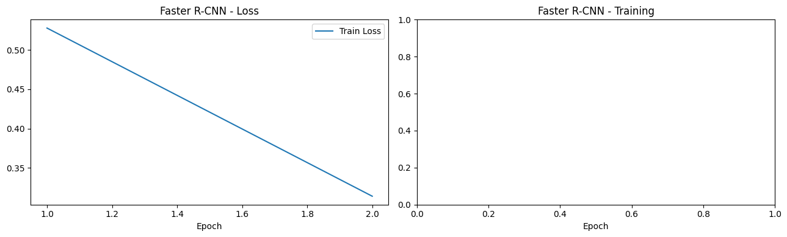

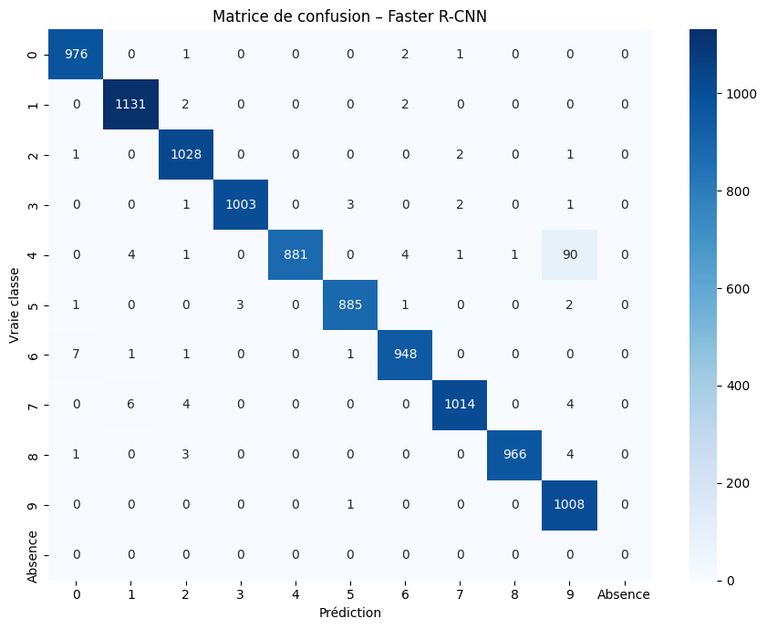

### VGG16 et AlexNet

Pour cette étape, j'ai utilisé les versions préentraînées de **VGG16** et **AlexNet** et adapté leurs couches de classification à nos dix chiffres. Les images MNIST ont été redimensionnées en 224 × 224 et converties en trois canaux pour ces modèles.

Les deux modèles ont été entraînés pendant **3 epochs**.

| Modèle | Accuracy (test) | Macro F1 (test) | Training time |
| ------- | --------------: | --------------: | ------------: |
| VGG16   |         99,43 % |          0,9942 |     1 143,7 s |
| AlexNet |         99,41 % |          0,9941 |       203,5 s |

Les deux modèles donnent des résultats très proches. VGG16 a une Accuracy légèrement plus élevée, mais AlexNet s'entraîne plus rapidement dans cette expérience.

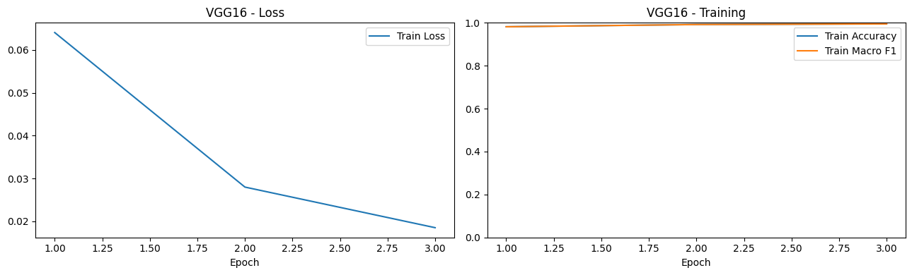

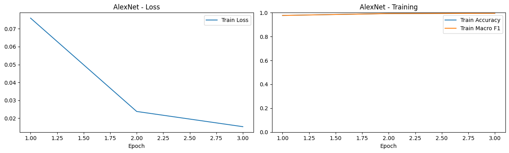

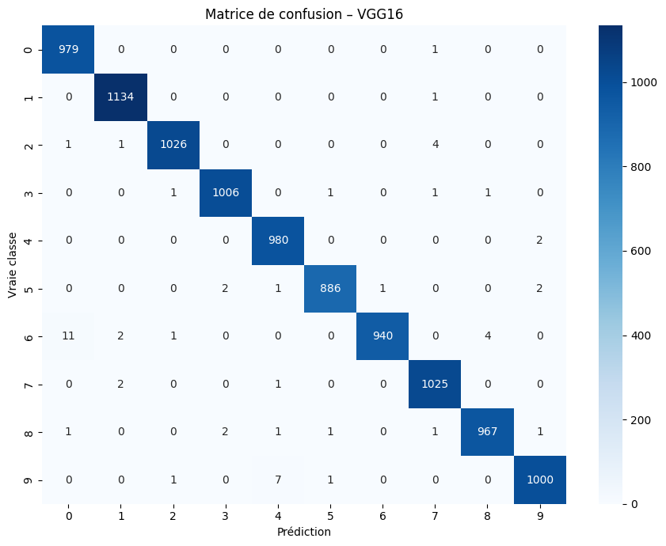

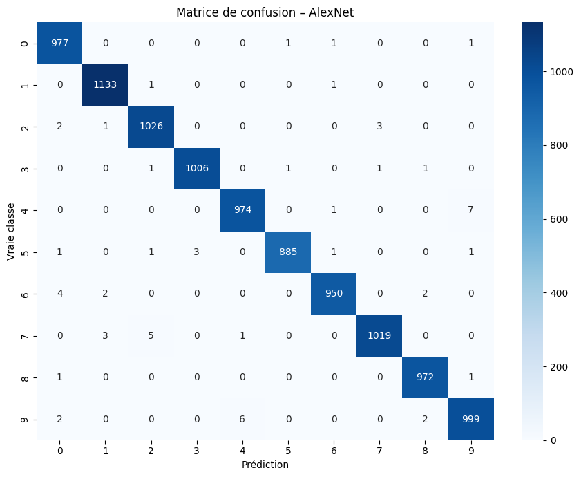

### Comparaison des modèles de la partie 1

| Modèle      |          Accuracy |         Macro F1 | Test Loss | Temps (s) | Epochs |
| ------------ | ----------------: | ---------------: | --------: | --------: | -----: |
| CNN          |           99,11 % |           0,9910 |    0,0286 |      46,4 |      5 |
| Faster R-CNN |           98,40 % |           0,9839 |    0,3348 |   1 638,0 |      2 |
| VGG16        | **99,43 %** | **0,9942** |    0,0223 |   1 143,7 |      3 |
| AlexNet      |           99,41 % |           0,9941 |    0,0190 |     203,5 |      3 |

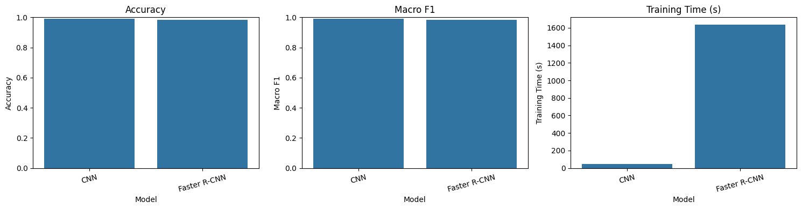

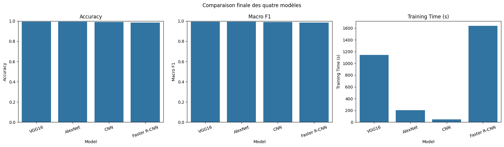

Dans cette première partie, **VGG16** obtient le meilleur score, alors que **CNN** est le plus rapide à entraîner. Faster R-CNN demande beaucoup plus de temps pour cette tâche de classification de chiffres.

Il faut toutefois distinguer les fonctions de perte : Faster R-CNN utilise plusieurs pertes liées à la détection, alors que les autres modèles utilisent CrossEntropy. Les valeurs de Loss ne sont donc pas directement comparables. Les temps dépendent aussi du nombre d'epochs et de l'utilisation de poids préentraînés.

## 3. Partie 2 - Vision Transformer (ViT)

### Construction du ViT

Dans la deuxième partie, j'ai construit un **Vision Transformer à partir de zéro** avec PyTorch, sans poids préentraînés. Les images 28 × 28 sont découpées en petits patches de 4 × 4. Le modèle utilise ensuite un mécanisme de self-attention pour traiter ces patches.

La configuration utilisée est la suivante :

| Paramètre                |  Valeur |
| ------------------------- | ------: |
| Patch size                |  4 × 4 |
| Nombre de patches         |      49 |
| Embedding dimension       |     128 |
| Attention heads           |       4 |
| Transformer blocks        |       4 |
| Epochs                    |      12 |
| Batch size                |     256 |
| Learning rate initial     |  0,0005 |
| Paramètres entraînables | 540 170 |

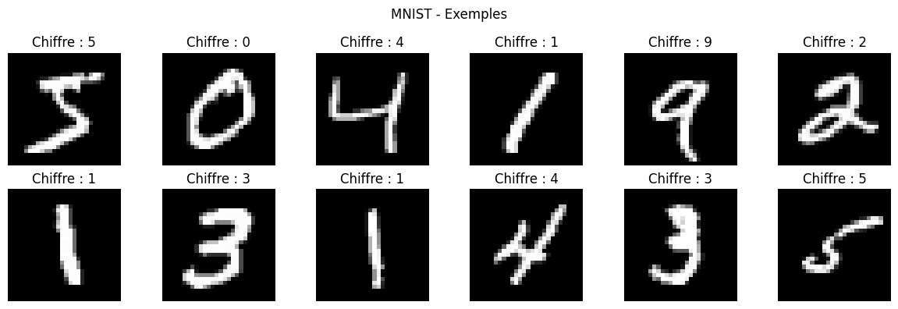

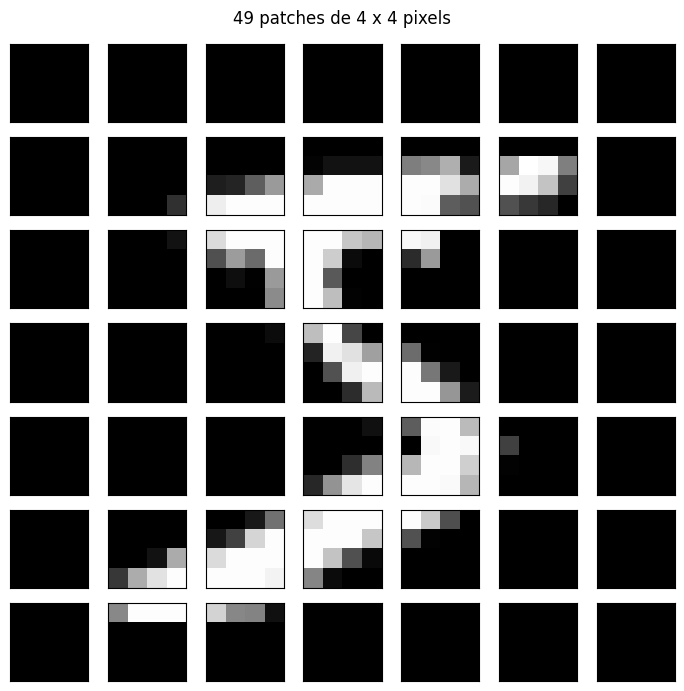

### Entraînement et résultats

J'ai entraîné le ViT sur les **60 000 images MNIST** pendant **12 epochs**, en utilisant AdamW et un scheduler du learning rate.

Les résultats sur les 10 000 images de test sont :

- **Accuracy : 97,79 %**
- **Macro F1-score : 0,9777**
- **Test Loss : 0,0726**
- **Temps d'entraînement : 60,94 s**
- **Nombre d'erreurs : 221 images**

Les courbes montrent que la Loss diminue et que l'Accuracy augmente pendant l'entraînement. Le ViT apprend bien les chiffres MNIST, mais il reste un peu moins précis que les modèles de la première partie.

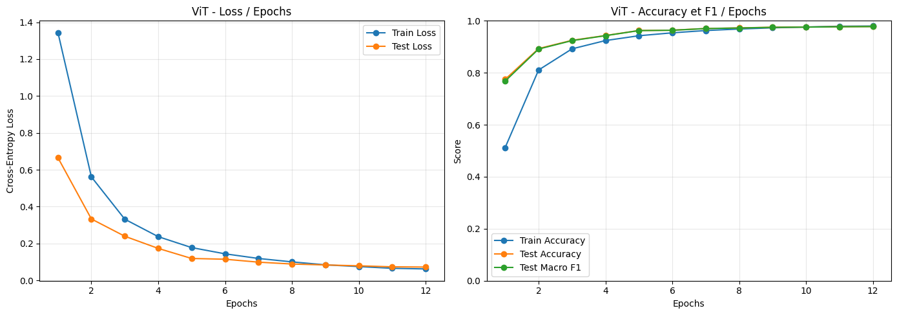

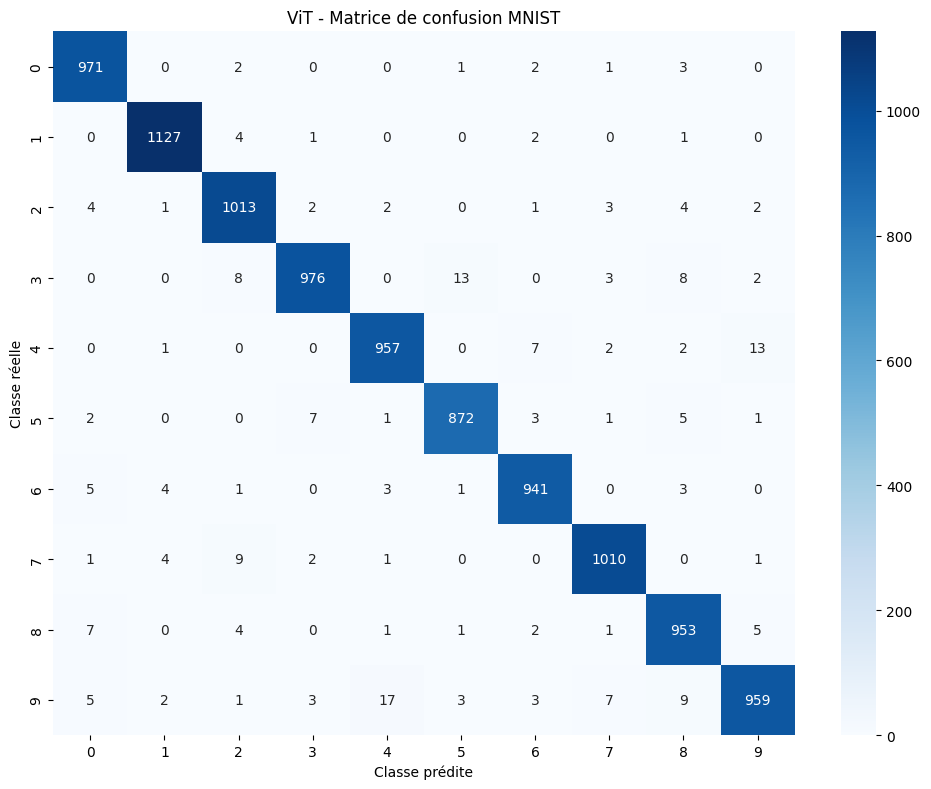

Voici quelques exemples d'images mal classées :

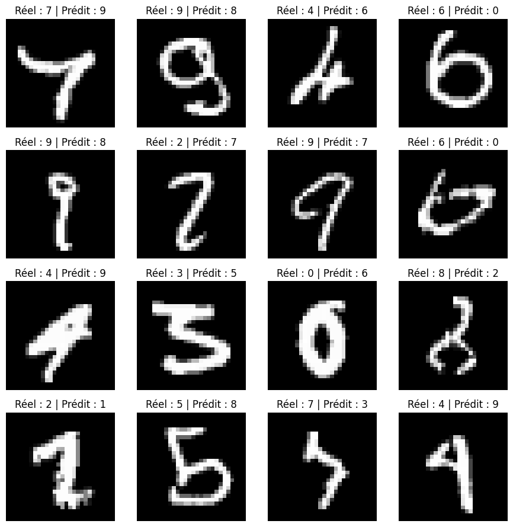

## 4. Comparaison finale

| Modèle            |   Accuracy (test) |  Macro F1 (test) | Temps d'entraînement | Epochs |
| ------------------ | ----------------: | ---------------: | --------------------: | -----: |
| VGG16              | **99,43 %** | **0,9942** |             1 143,7 s |      3 |
| AlexNet            |           99,41 % |           0,9941 |               203,5 s |      3 |
| CNN                |           99,11 % |           0,9910 |                46,4 s |      5 |
| Faster R-CNN       |           98,40 % |           0,9839 |             1 638,0 s |      2 |
| ViT (from scratch) |           97,79 % |           0,9777 |               60,94 s |     12 |

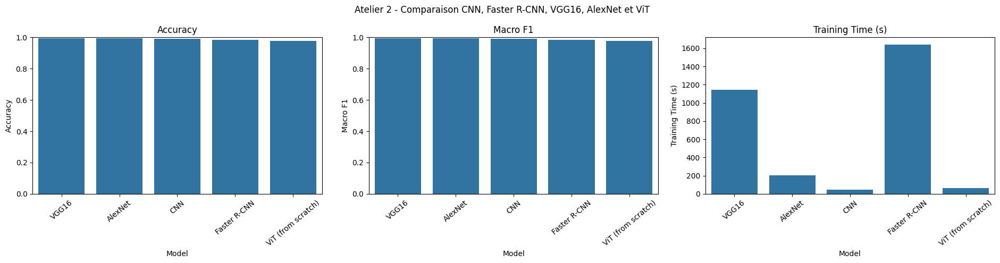

Pour ces expériences, **VGG16 donne la meilleure Accuracy**, suivi de très près par AlexNet. Le CNN simple est également performant, avec un temps d'entraînement réduit. Le ViT construit à partir de zéro obtient le résultat le plus faible parmi les cinq, mais son Accuracy reste supérieure à 97 %.

Cette comparaison a ses limites : les architectures sont différentes, les modèles n'utilisent pas tous des poids préentraînés et le nombre d'epochs n'est pas le même. Pour le ViT, les résultats de test ont aussi été affichés après chaque epoch, sans ensemble de validation séparé. Les scores présentés sont donc ceux de ces exécutions, pas un classement général des architectures.

## 5. Synthèse personnelle

Ce TP m'a permis de mieux comprendre la classification d'images avec PyTorch. J'ai appris à construire un CNN avec des couches de convolution et de pooling, puis à utiliser un modèle de détection comme Faster R-CNN.

J'ai aussi découvert comment adapter des modèles préentraînés comme VGG16 et AlexNet à un nouveau dataset. Dans la deuxième partie, j'ai pu construire un Vision Transformer à partir de zéro et comprendre le rôle des patches et de la self-attention.

Ce qui m'a surtout marqué, c'est que le modèle le plus complexe n'est pas toujours le plus intéressant. Il faut comparer la précision, le temps d'entraînement et les contraintes de chaque méthode. Sur MNIST, un CNN assez simple donne déjà de très bons résultats.

## 6. Outils et données

- **Environnement :** Kaggle Notebook, GPU Tesla T4
- **Bibliothèques :** Python, PyTorch, TorchVision, NumPy, Pandas, Scikit-learn, Matplotlib, Seaborn
- **Dataset :** [MNIST - Kaggle](https://www.kaggle.com/datasets/hojjatk/mnist-dataset)

Pour réexécuter les notebooks sur Kaggle, il faut ajouter le dataset MNIST (les quatre fichiers IDX) et activer le GPU. Le notebook de la première partie utilise aussi des poids préentraînés téléchargés avec TorchVision, donc un accès Internet est nécessaire pour le premier téléchargement.

Les figures de ce README sont extraites directement des sorties des deux notebooks exécutés.
